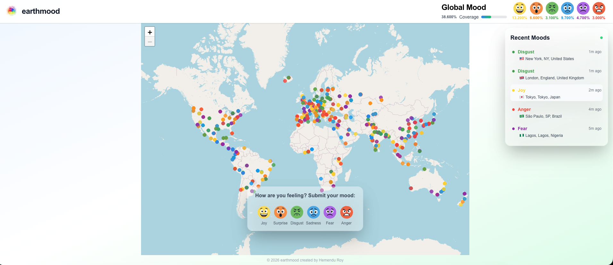

# EarthMood 🌍

Track and visualize global mood on an interactive world map. See how people around the world are feeling in real-time.

**Created by Hemendu Roy**

## Screenshot



## Before making this repository public

- **Secrets:** Confirm no `.env.local`, API keys, or database passwords are committed. Tracked `frontend/.env.example` should stay placeholder-only. Rotate any key that ever appeared in git history.
- **GitHub Actions:** Workflow uses repository secrets (`SUPABASE_ACCESS_TOKEN`, `VERCEL_TOKEN`, etc.). The Supabase **project ref** in `.github/workflows/deploy.yml` is metadata (similar to your public project URL); treat it as non-secret but expect it to identify your project.
- **Optional scan:** Run [gitleaks](https://github.com/gitleaks/gitleaks) or [TruffleHog](https://github.com/trufflesecurity/trufflehog) on a full clone if you want automated history review.

## README media & local mock data

To capture UI without a live Supabase project:

1. In `frontend/.env.local` set `SCREENSHOT_MOCK=1` (see `frontend/.env.example`).
2. Run `npm run dev` from the **repository root** (or `cd frontend && npm run dev`).
3. Map dots, global stats, recent moods, and mood **POST** responses use built-in fixtures.

Do **not** enable `SCREENSHOT_MOCK` in production or in Vercel.

## 🏗️ Project Structure

This is a modern web application built with:

- **Frontend**: Next.js 14 with TypeScript and App Router
- **Database**: Supabase (PostgreSQL with PostGIS)
- **Deployment**: Vercel (free tier)

## 🚀 Quick Start

### Prerequisites
- Node.js 18+
- Supabase account (free)

### Installation

1. **Clone and install dependencies**
   ```bash
   git clone <repository-url>
   cd <repo>
   npm run install:all
   ```

   The Next.js app lives in `frontend/`. From the repo root, `npm run dev` runs it. (Alternatively: `cd frontend && npm install && npm run dev`.)

2. **Set up Supabase**
   - Go to [supabase.com](https://supabase.com) and create a free account
   - Create a new project named "earthmood"
   - Copy your project URL and anon key from Settings → API
   - Run the SQL schema in the SQL Editor (copy from `supabase/schema.sql`)

3. **Set environment variables**
   ```bash
   cp frontend/.env.example frontend/.env.local
   ```
   
   Edit `frontend/.env.local` with your Supabase credentials:
   ```bash
   NEXT_PUBLIC_SUPABASE_URL=your-supabase-project-url
   NEXT_PUBLIC_SUPABASE_ANON_KEY=your-supabase-anon-key
   ```

4. **Start development server** (from repo root)
   ```bash
   npm run dev
   ```

Visit [http://localhost:3000](http://localhost:3000) to see your app!

## 📁 Directory Structure

```
earthmood/
├── frontend/              # Next.js React app (main project)
│   ├── src/
│   │   ├── app/          # App router pages and API routes
│   │   ├── components/   # React components
│   │   └── utils/        # Utility functions
│   ├── public/           # Static assets
│   ├── scripts/          # Database and utility scripts
│   └── package.json      # All dependencies and scripts
├── supabase/             # Supabase configuration and migrations
│   ├── config.toml       # Supabase project configuration
│   ├── migrations/       # Database migrations
│   └── schema.sql        # Main schema file
└── .github/              # GitHub Actions workflows
```

## 🗄️ Database Design

The application uses Supabase (PostgreSQL) with PostGIS for efficient geospatial queries:

- **`mood_entries`** - Individual mood submissions with location data
- **`mood_aggregations`** - Pre-computed data for efficient map rendering
- **Spatial indexes** - For fast location-based queries
- **Time-series optimization** - For historical data analysis

## 🎯 Features

- **Real-time mood tracking** - Submit your mood with location
- **Interactive world map** - Visualize global mood patterns
- **Time-based filtering** - View mood data over different time periods
- **Efficient rendering** - Handles millions of data points with aggregation
- **Responsive design** - Works on desktop and mobile
- **Completely free** - Runs on Vercel + Supabase free tiers

## 🛠️ Development

### Available Scripts

```bash
# Development
npm run dev              # Start development server
npm run build            # Build for production
npm run start            # Start production server
npm run lint             # Run code linting

# Database Management
npm run db:push          # Deploy database changes
npm run db:status        # Check database migration status
npm run db:diff          # Show database changes
npm run db:generate      # Create new migration
npm run db:reset         # Reset database (development only)
```

### Project Structure

The project uses a simplified, single-app structure:

- **`frontend/`** - Contains the entire Next.js application
- **`supabase/`** - Database configuration and migrations
- **All scripts and dependencies** are consolidated in `frontend/package.json`

This structure eliminates unnecessary complexity while maintaining professional organization.

## 🚀 Deployment

The app is deployed on Vercel with automatic deployments from the main branch.

## 📝 License

This project is open source and available under the MIT License.
